# Лабораторна робота 05. RESTful API з документацією — магазин «Кубик»

| | |
|---|---|
| **Проєкт** | REST API інтернет-магазину настільних ігор «Кубик» (продовження лабораторних 03–04) |
| **Виконавець** | Пламетюк Ілля, група ІПЗ, GitHub [istdjfgh](https://github.com/istdjfgh) |
| **Склад команди** | роботу виконано **одноосібно** — проєктування API, код, документацію, тести Postman і звіт зробив автор |
| **Виконані рівні** | Рівень 1 (35 ендпоінтів, JSON, обробка помилок, колекція Postman), Рівень 2 (документація flasgger), Рівень 3 (валідація, дві версії API, коди статусу) |
| **Коміти** | [історія комітів](https://github.com/istdjfgh/opi-lab05-rest-api/commits/main) |

## 1. Опис API і технології

API працює поверх бази даних SQLite з лабораторної 04 (товари, категорії з вкладеністю, замовлення, клієнти, відгуки, промокоди) і використовує ті самі функції моделей, що й сайт та адмін-панель, — дані й правила спільні.

| Технологія | Для чого |
|------------|----------|
| Python 3.13, **Flask 3.1** | Blueprint-и `api_v1` (`/api/v1`) і `api_v2` (`/api/v2`), обробники помилок |
| **SQLite** | база даних з лабораторної 04, параметризовані запити, транзакції |
| **flasgger** (Swagger UI, OpenAPI 2.0) | документація на `/apidocs/`, дві специфікації: `/apispec_v1.json`, `/apispec_v2.json` |
| **Postman** / newman | колекція `postman_collection.json` (51 запит, 101 перевірка `pm.test`) |
| pytest | 164 автотести (з них 65 — для API), покриття коду 97 % |

**Принципи, яких дотримано:**
- ресурси — іменники в множині (`/products`, `/orders/{id}`), дія задається HTTP-методом;
- **stateless**: API не використовує cookie-сесію, для операцій зміни ключ передається в кожному запиті заголовком `X-API-Key`;
- правильні коди відповідей і заголовки: `201 Created` + `Location`, `204 No Content` після видалення, `405` + `Allow`;
- усі відповіді й помилки — у JSON (кирилиця без `\uXXXX`).

**Доступ.** Читання каталогу, оформлення замовлення, відгуки й перевірка промокоду — публічні (як на сайті). Створення/зміна/видалення, замовлення, клієнти й статистика — лише з ключем: `X-API-Key: <API_KEY>` (змінна середовища; для навчального запуску — `dev-api-key`).

## 2. Ендпоінти

### Версія 1 — `/api/v1` (22 ендпоінти)

| Метод | Адреса | Призначення | Ключ | Коди відповідей |
|-------|--------|-------------|:----:|-----------------|
| GET | `/health` | перевірка роботи сервісу | | 200 |
| GET | `/stats` | статистика магазину | 🔑 | 200, 401 |
| GET | `/products` | список товарів; `q`, `category`, `min_price`, `max_price`, `players`, `in_stock`, `sort` | | 200, 400 |
| GET | `/products/{id}` | один товар | | 200, 404 |
| POST | `/products` | створити товар | 🔑 | 201, 400, 401, 409, 415 |
| PUT | `/products/{id}` | повна заміна товару | 🔑 | 200, 400, 401, 404, 409 |
| PATCH | `/products/{id}` | часткова зміна (ціна, залишок…) | 🔑 | 200, 400, 401, 404 |
| DELETE | `/products/{id}` | видалити товар | 🔑 | 204, 401, 404, 409 |
| GET | `/categories` | усі категорії (з `parent_id`, кількістю товарів) | | 200 |
| GET | `/categories/{id}` | одна категорія | | 200, 404 |
| POST | `/categories` | створити категорію / підкатегорію | 🔑 | 201, 400, 401, 409 |
| DELETE | `/categories/{id}` | видалити категорію | 🔑 | 204, 401, 404, 409 |
| GET | `/orders` | замовлення, фільтр `status` | 🔑 | 200, 400, 401 |
| GET | `/orders/{id}` | замовлення з позиціями | 🔑 | 200, 401, 404 |
| POST | `/orders` | оформити замовлення (публічний) | | 201, 400, 409, 415 |
| PATCH | `/orders/{id}` | змінити статус | 🔑 | 200, 400, 401, 404 |
| DELETE | `/orders/{id}` | видалити замовлення | 🔑 | 204, 401, 404 |
| GET | `/customers` | клієнти з кількістю й сумою замовлень, пошук `q` | 🔑 | 200, 401 |
| GET | `/customers/{id}` | клієнт з історією замовлень | 🔑 | 200, 401, 404 |
| GET | `/feedback` | відгуки (без email) | | 200 |
| POST | `/feedback` | залишити відгук | | 201, 400, 415 |
| POST | `/promo-codes/check` | перевірити промокод для суми | | 200, 400 |

### Версія 2 — `/api/v2` (13 ендпоінтів)

| Метод | Адреса | Призначення | Ключ | Коди |
|-------|--------|-------------|:----:|------|
| GET | `/` | точка входу з посиланнями на ресурси | | 200 |
| GET | `/products` | товари **посторінково** (`page`, `per_page` ≤ 50) + фільтри | | 200, 400 |
| GET | `/products/{id}` | товар у новому форматі | | 200, 404 |
| POST / PUT / PATCH / DELETE | `/products`, `/products/{id}` | керування товарами | 🔑 | 201 / 200 / 204, 400, 401, 404, 409 |
| GET | `/categories` | **дерево** категорій (`children`) | | 200 |
| GET | `/orders` | замовлення посторінково, фільтр `status` | 🔑 | 200, 400, 401 |
| GET | `/orders/{id}` | замовлення з позиціями | 🔑 | 200, 404 |
| POST | `/orders` | оформити замовлення | | 201, 400, 409 |
| PATCH | `/orders/{id}` | змінити статус | 🔑 | 200, 400, 404 |
| POST | `/promo-codes/check` | перевірити промокод | | 200, 400 |

### Приклад: оформлення замовлення

```http
POST /api/v1/orders
Content-Type: application/json

{
  "customer": {"name": "Ілля Пламетюк", "email": "student@example.com", "phone": "+380 67 123 45 67", "city": "Луцьк"},
  "address": "Відділення Нової пошти №3",
  "items": [{"product_id": 11, "quantity": 2}],
  "promo_code": "WELCOME10"
}
```
```http
HTTP/1.1 201 CREATED
Location: /api/v1/orders/7

{"id": 7, "status": "Нове", "subtotal": 780.0, "discount": 78.0, "total": 702.0, "promo_code": "WELCOME10", "items": [...]}
```
Ціни беруться з бази (а не з запиту), залишки списуються, клієнт знаходиться за email або створюється — усе однією транзакцією.

## 3. Версії API (рівень 3)

Версія вказується в адресі; кожна версія — окремий Blueprint з префіксом. Логіка й перевірки спільні (`routes/api/services.py`), версії відрізняються лише форматом відповідей:

| | v1 | v2 |
|---|---|---|
| Список | масив `[...]` | конверт `{"data": [...], "meta": {...}, "links": {...}}` |
| Пагінація | немає | `?page=2&per_page=5` → `meta: {page, per_page, total, pages}`, `links: {self, first, last, next, prev}` (фільтри зберігаються в посиланнях) |
| Ціна | `"price": 1150.0` | `"price": {"amount": 1150.0, "currency": "UAH"}` |
| Категорія товару | `category_id`, `category_name`, … | вкладений об’єкт `"category": {"id", "name", "slug"}` |
| Гравці | `players_min`, `players_max` | `"players": {"min": 2, "max": 5}`, додано `in_stock` |
| Посилання | — | `links.self`, `links.html` у кожного ресурсу |
| Категорії | плоский список | дерево з `children` |
| Помилка | `{"error": "...", "details": {...}}` | `{"error": {"status", "code", "message", "fields"}}` |

Відповіді v1 містять заголовки `Deprecation: true` і `Link: </api/v2/>; rel="successor-version"` — старі клієнти продовжують працювати, а нові дізнаються, що є наступна версія.

## 4. Валідація та обробка помилок (рівень 3)

Модуль `api_validation.py` перевіряє тіло кожного запиту:
- **типи** — `"price": "100"` (рядок) або `"stock": 1.5` відхиляються; `true/false` не приймаються як числа;
- **обов’язкові поля, довжини й діапазони** — ціна 0–100000, оцінка 1–5, кількість у замовленні 1–10, `per_page` 1–50;
- **формати** — slug (`^[a-z0-9-]+$`), email, телефон, колір `#RRGGBB`, дата `YYYY-MM-DD`;
- **логічні правила** — `players_min ≤ players_max`, підкатегорія лише в категорії верхнього рівня, товар не повторюється в замовленні, категорія й товари мають існувати, промокод має діяти;
- **невідомі поля** — `"colour"` замість `"color"` дає помилку, а не тихо ігнорується;
- **вкладені поля** — помилки адресуються шляхом: `customer.email`, `items[0].quantity`.

Помилки повертаються **всі одразу**, по полях, щоб клієнт міг показати їх біля відповідних полів форми.

| Код | Коли |
|-----|------|
| 400 Bad Request | помилки валідації, зламаний JSON, тіло не є об’єктом, некоректні параметри (`?category=nope`, `?per_page=500`) |
| 401 Unauthorized | немає або неправильний `X-API-Key` |
| 404 Not Found | неіснуючий id або адреса (у JSON, а сайт і далі показує HTML-сторінку 404) |
| 405 Method Not Allowed | метод не підтримується; заголовок `Allow` перелічує дозволені |
| 409 Conflict | дублікат slug, видалення товару з замовлень / категорії з товарами, нестача товару на складі |
| 415 Unsupported Media Type | тіло запиту не JSON |
| 500 Internal Server Error | непередбачена помилка — лог на сервері, клієнту JSON без подробиць |

## 5. Документація (рівень 2)

Документацію генерує **flasgger** з опису у форматі OpenAPI (YAML у docstring кожного ендпоінта) і спільних схем даних (`routes/api/docs.py`). Сторінка **`/apidocs/`** — інтерактивний Swagger UI: опис усіх ендпоінтів, параметрів, схем запитів і відповідей, приклади, кнопка **Authorize** для ключа та **Try it out** для виконання запиту. Специфікація v2 відкривається введенням `/apispec_v2.json` у полі вгорі сторінки (кнопка Explore). Автотест перевіряє, що **кожен** маршрут `/api/...` описаний у документації.

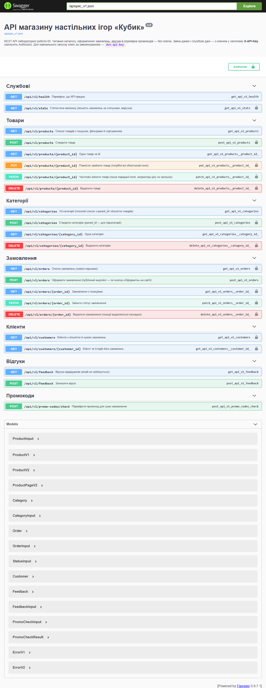

<details><summary>Специфікація v2 у Swagger UI</summary>

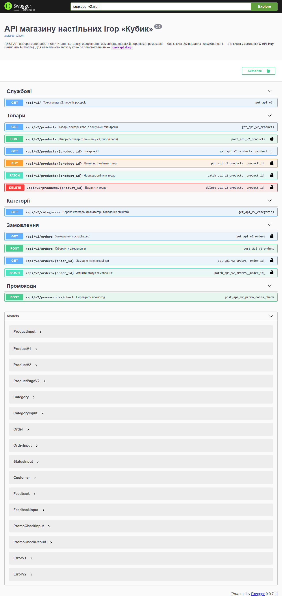
</details>

## 6. Тестування

### Postman (колекція `postman_collection.json`)

Колекція містить 6 папок і **51 запит**; для кожного ресурсу є успішні сценарії й сценарії з помилкою (неіснуючий id, порожні поля, хибні типи, відсутній ключ, не JSON, конфлікт). Кожен запит має перевірки `pm.test` (код статусу, структура й значення відповіді, заголовки, час відповіді). Запити пов’язані змінними: id створеного товару/категорії/замовлення зберігається (`pm.collectionVariables.set`) і використовується в наступних запитах — повний цикл CRUD.

Колекцію згенеровано скриптом `scripts/build_postman_collection.py`, імпортується в Postman (Import → файл) або Bruno. Автоматичний прогін — `python scripts/run_newman.py` (newman — консольний запуск колекцій Postman), звіт: [lab-reports/newman/report.html](lab-reports/newman/report.html).

**Результат: 51 запит, 101 перевірка, 0 помилок.**

| Звіт newman | Запити за папками |
|---|---|
| 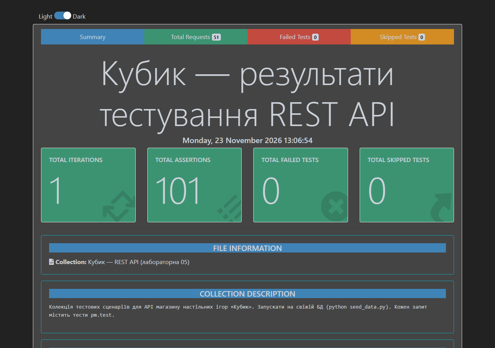 | 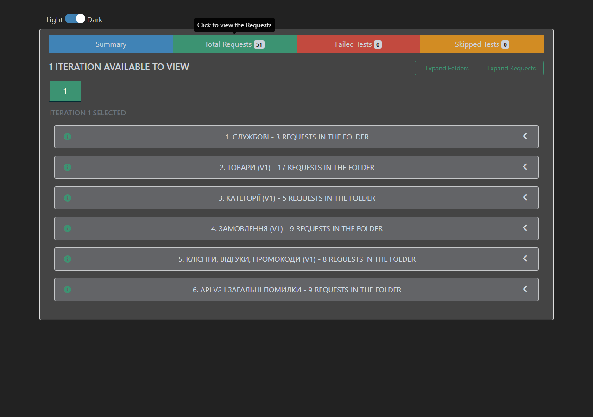 |

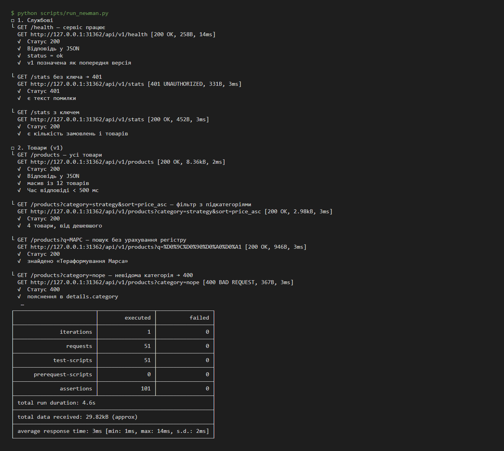

### Приклади запитів (Swagger UI → Try it out)

| Успішний запит: `GET /api/v1/products/1` → 200 | Запит з помилкою: `GET /api/v1/products/999` → 404 |
|---|---|
| 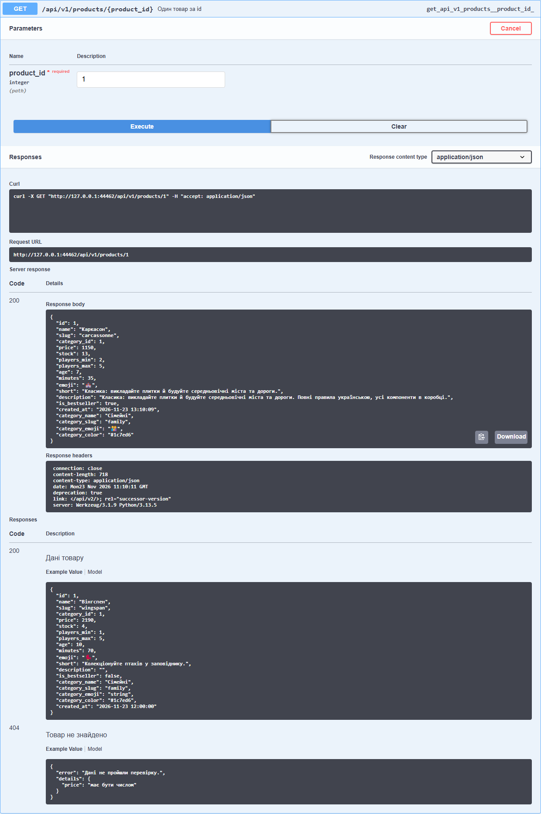 | 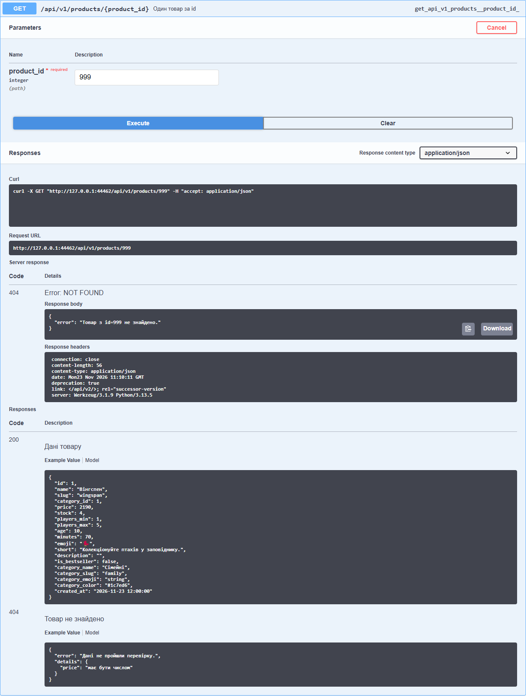 |

| Валідація: `POST /api/v1/products` → 400 з помилками по полях | Оформлення замовлення: `POST /api/v1/orders` → 201 |
|---|---|
| 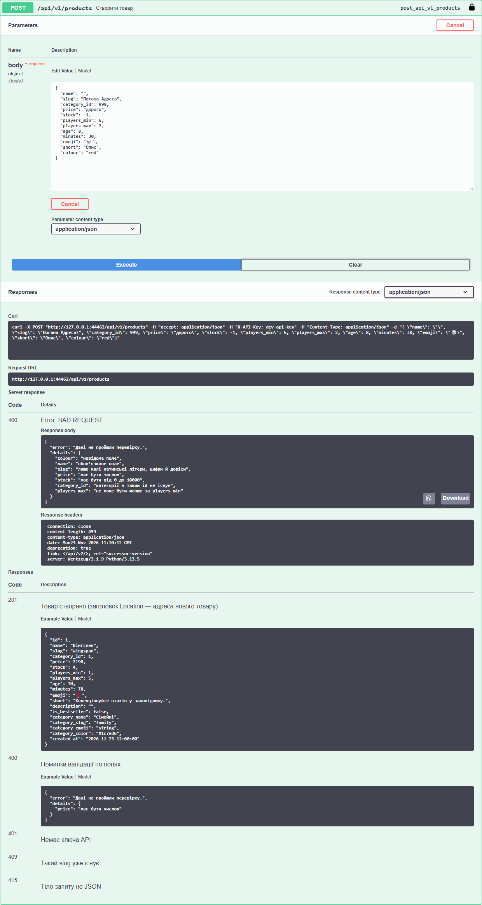 | 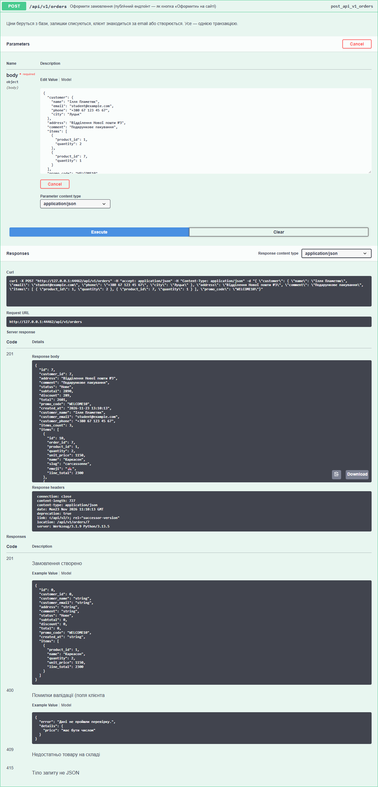 |

| v2: пагінація `GET /api/v2/products?per_page=2&page=2` | v2: формат помилки 404 |
|---|---|
| 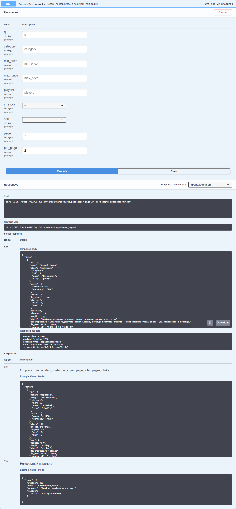 | 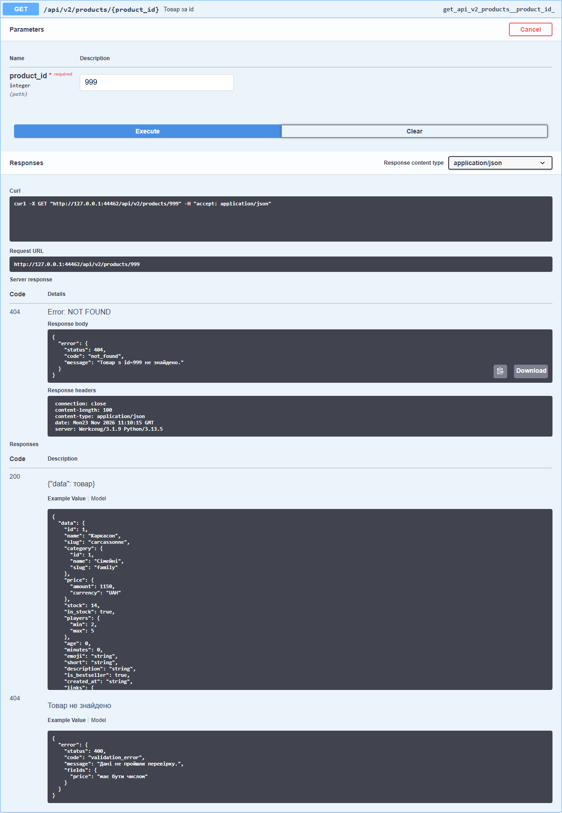 |

Конфлікт `DELETE /api/v1/products/1` → 409 (товар є в замовленнях):

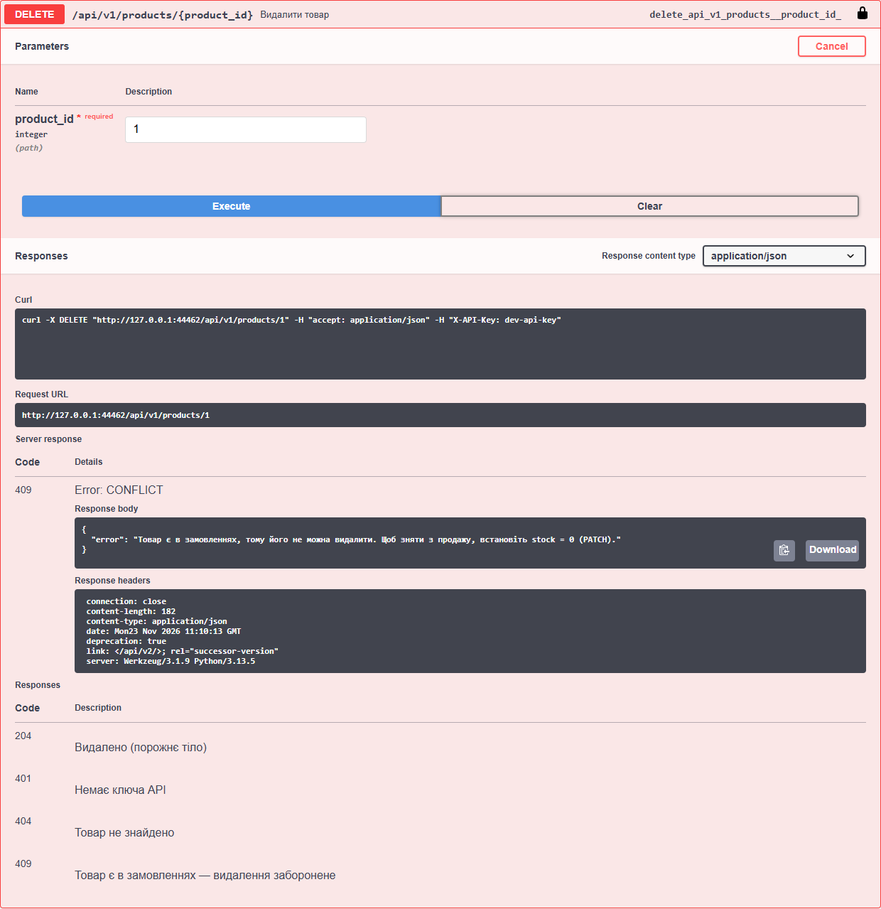

### Автотести pytest

```
pytest --cov=.        164 passed, покриття 97 %
```
| Файл | Що перевіряється |
|------|------------------|
| `tests/test_api_v1.py` | усі ендпоінти v1: CRUD товарів, категорій, замовлень, клієнти, відгуки, промокоди, вплив на БД (залишки, суми, каскад), `Location`, `Deprecation` |
| `tests/test_api_v2.py` | конверт `data/meta/links`, пагінація і посилання з фільтрами, новий формат товару й замовлення, дерево категорій, формат помилок v2 |
| `tests/test_api_errors.py` | 400/401/404/405/409/415/500, перевірка типів, діапазонів, невідомих і вкладених полів, SQL-ін’єкція, звільнення API від CSRF, повнота документації OpenAPI |
| інші файли | сайт і адмін-панель з лабораторної 04 (усе продовжує працювати) |

## 7. Запуск

```bash
python -m venv .venv
.venv\Scripts\activate            # macOS / Linux: source .venv/bin/activate
pip install -r requirements.txt
python seed_data.py               # тестові дані
python app.py                     # http://127.0.0.1:5000  ·  API: /api/v1, /api/v2  ·  документація: /apidocs/
```
```bash
curl http://127.0.0.1:5000/api/v2/products?per_page=3
curl -X PATCH http://127.0.0.1:5000/api/v1/products/2 -H "X-API-Key: dev-api-key" -H "Content-Type: application/json" -d "{\"stock\": 0}"
```
Тести: `pip install -r requirements-dev.txt`, `pytest`; колекція Postman: `npm i -g newman newman-reporter-htmlextra`, `python scripts/run_newman.py`.

### Структура (нове порівняно з лабораторною 04)
```
routes/api/
  common.py      помилки у JSON (формат v1/v2), ключ X-API-Key, читання JSON, 201 + Location
  services.py    спільна логіка обох версій: перевірки, конфлікти, транзакції через моделі
  v1.py          ендпоінти v1 з описом OpenAPI у docstring
  v2.py          ендпоінти v2: конверт, пагінація, вкладені об’єкти, посилання
  docs.py        flasgger: дві специфікації, схеми даних, схема авторизації
api_validation.py         валідація JSON-тіл
postman_collection.json   колекція Postman із тестами
scripts/                  генерація колекції, прогін newman, скриншоти
```

## 8. Висновки

Я розробив REST API для магазину настільних ігор: 35 ендпоінтів у двох версіях, які покривають усі ресурси бази даних з лабораторної 04 і коректно використовують HTTP-методи, коди відповідей і заголовки. Валідація перевіряє типи, діапазони, формати й логічні правила та повертає зрозумілі помилки по полях, а для всіх помилок, зокрема 404, 405 і 500, API відповідає в JSON. Документація flasgger з інтерактивним Swagger UI і колекція Postman (51 запит, 101 перевірка без помилок) разом із 164 автотестами підтверджують, що API працює правильно. Версіонування показало, як змінювати формат відповідей, не ламаючи наявних клієнтів.

## 9. Відповіді на контрольні запитання

**1. Що таке API? Поясніть на прикладі.**
API (Application Programming Interface) — набір правил, за якими одна програма звертається до іншої: які запити можна надіслати і які відповіді прийдуть. Приклад із проєкту: мобільний застосунок магазину не має доступу до бази даних, але надсилає `GET /api/v2/products?category=strategy` і отримує список стратегій у JSON, а замовлення оформлює через `POST /api/v1/orders`. Як офіціант у ресторані, API приймає замовлення в зрозумілому форматі й повертає результат, приховуючи «кухню» (базу даних і логіку).

**2. Що таке REST? Назвіть його основні принципи.**
REST (Representational State Transfer) — архітектурний стиль вебсервісів (Рой Філдінг, 2000). Принципи: клієнт-серверна архітектура; відсутність стану (stateless); кешованість відповідей; єдиний інтерфейс (ресурси з унікальними адресами, стандартні HTTP-методи, самоописові повідомлення, посилання між ресурсами — HATEOAS, як `links` у v2); багаторівнева система (клієнт не знає, чи є між ним і сервером проксі); код на вимогу (необов’язковий).

**3. Що означає принцип відсутності стану (stateless)?**
Сервер не зберігає між запитами інформацію про клієнта: кожен запит містить усе потрібне для обробки. У проєкті API не використовує сесію — ключ `X-API-Key` надсилається в кожному запиті, а номер сторінки — у параметрі `page`. Завдяки цьому будь-який екземпляр сервера може обробити будь-який запит, API легко масштабувати.

**4. Яким операціям CRUD відповідають HTTP-методи GET, POST, PUT/PATCH, DELETE? Чим відрізняються PUT і PATCH?**
Create — POST, Read — GET, Update — PUT/PATCH, Delete — DELETE. PUT **повністю замінює** ресурс: треба передати всі поля (у проєкті `PUT /products/1` без `name` дає 400). PATCH **частково змінює** ресурс: передаються лише змінені поля (`PATCH /products/2 {"stock": 0}`), решта залишаються як були.

**5. Що таке ідемпотентність? Які HTTP-методи є ідемпотентними?**
Ідемпотентний запит при повторенні дає той самий стан сервера, що й одноразовий. Ідемпотентні: GET, HEAD, OPTIONS, PUT, DELETE (повторний `DELETE /products/13` поверне 404, але стан бази вже не зміниться). POST не ідемпотентний: два однакові `POST /orders` створять два замовлення. PATCH у загальному випадку не гарантує ідемпотентності (наприклад, «збільшити на 1»), хоча наш PATCH зі встановленням значень фактично ідемпотентний.

**6. Які групи кодів відповідей HTTP існують? Коли API має повертати коди 200, 201, 400, 404?**
1xx — інформаційні, 2xx — успіх, 3xx — перенаправлення, 4xx — помилка клієнта, 5xx — помилка сервера. **200 OK** — успішне читання чи зміна (`GET /products`, `PATCH /orders/1`); **201 Created** — створено новий ресурс (`POST /products`, із заголовком `Location`); **400 Bad Request** — запит некоректний (не пройшла валідація, зламаний JSON); **404 Not Found** — ресурсу не існує (`GET /products/999`).

**7. Чому API повертає у форматі JSON не лише дані, а й повідомлення про помилки?**
Клієнт API — програма, а не людина, тому вона має однаково розбирати будь-яку відповідь. HTML-сторінку помилки програма не прочитає, а JSON `{"error": ..., "details": {"price": "має бути числом"}}` можна обробити: показати повідомлення біля потрібного поля, відрізнити помилку валідації від конфлікту за кодом. Тому в проєкті навіть 404 для неіснуючої адреси, 405 і 500 для `/api/...` повертаються в JSON.

**8. Навіщо документувати API і що таке Swagger (OpenAPI)?**
Документація пояснює розробникам клієнтів, які є ендпоінти, параметри, формати запитів і відповідей, коди помилок і як авторизуватися — без читання коду сервера. OpenAPI — стандарт машиночитного опису REST API (JSON/YAML), а Swagger — набір інструментів для нього: Swagger UI показує опис як інтерактивну сторінку, де запит можна виконати кнопкою «Try it out». У проєкті flasgger будує специфікацію з docstring і показує її на `/apidocs/`.

**9. Навіщо потрібне версіонування API і як його можна реалізувати?**
Коли формат API змінюється несумісно (інша структура відповіді, перейменовані поля), старі клієнти зламаються. Версіонування дозволяє випустити нову версію, не чіпаючи стару: клієнти переходять поступово. Способи: номер в адресі (`/api/v1/…`, `/api/v2/…` — використано в проєкті через Blueprint з `url_prefix`), заголовок (`Accept: application/vnd.shop.v2+json`) або параметр запиту (`?version=2`). Застарілу версію позначають заголовками `Deprecation` / `Link: rel="successor-version"`, як у нашій v1.
